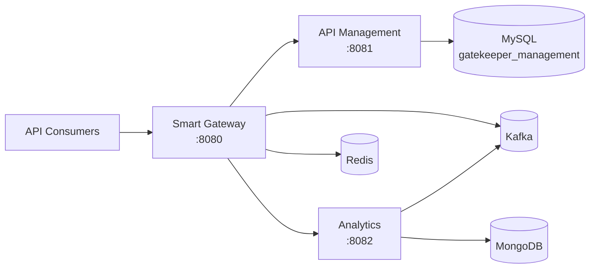

# Gatekeeper

Gatekeeper is an API platform built as three Spring Boot services:



## Services

| Service | Port | Purpose |
|---|---:|---|
| Smart Gateway | `8080` | Routes and protects API requests |
| API Management | `8081` | Manages API configuration, roles, accounts, and audit data |
| Analytics | `8082` | Processes and analyzes gateway events |

All services expose a public health endpoint:

```text
GET http://localhost:<port>/health
```

Other endpoints require authentication.

## Requirements

- Java 21+
- MySQL for API Management
- Redis and Kafka for the Smart Gateway
- MongoDB and Kafka for Analytics

API Management runs Flyway migrations automatically against the `gatekeeper_management` database.

## Run locally

Start the required infrastructure, then run each service from its directory:

```bash
./mvnw spring-boot:run
```

Example:

```bash
cd smart-gateway-service
./mvnw spring-boot:run
```

Run tests with:

```bash
./mvnw test
```

Service configuration is in each module's `src/main/resources/application.properties`.